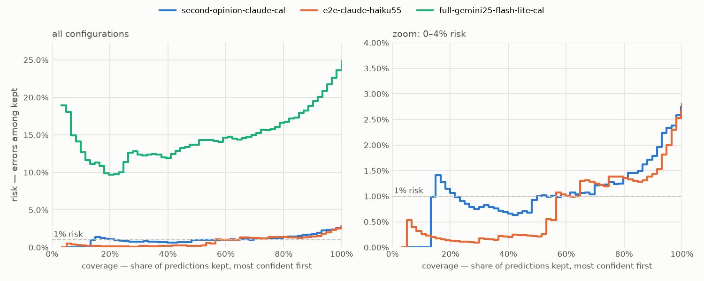

# MenuBench

[English](README.md) · **Русский**

Чтение цен из меню ресторанов (фото, сканы, PDF) и привязка их к кассовому каталогу — на одном правиле:
**неверная цена на экране хуже пустой рамки.** Поэтому каждая система здесь оценивается не только по точности, но и
по тому, знает ли она, какие из её ответов можно ставить на экран без проверки человеком.

**Результат:** если дать LLM привязывать позиции меню к каталогу напрямую, **27%** привязок указывают не на ту
позицию. Когда меню читает сильная модель, независимый конвейер её проверяет, уверенность откалибрована, а линкер
строгий, неверных привязок становится **1.2%**, и **66%** цен попадают на экраны без проверки при **1.1%** ошибок —
с порогом, выбранным на dev и только потом измеренным на test. Остальное уходит человеку с подсказкой, в топ-3
которой верная позиция каталога в 100% случаев.

| approach | pair F1 % | auto-placed % | wrong among auto-placed % | + box off the price % | wrong catalog links % | $/menu |
|---|---|---|---|---|---|---|
| Claude reads, pipeline checks, calibrated (v0.2) | 97.2 | 65.6 | 1.1 | 0.5 | 1.2 | 0.0052 |
| Claude Haiku 5.5, one call | 97.2 | – | – | – | – | 0.0014 |
| reference pipeline, calibrated (v0.1) | 70.6 | 4.8 | 15.3 | 0.5 | 6.1 | 0.0041 |
| reference pipeline + LLM picks the catalog item | 70.6 | 4.8 | 15.3 | 0.5 | 27.1 | 0.0042 |

Тестовая синтетика: 197 меню, 3 792 цены, 7 раскладок (2 не встречались при разработке), чистые, сканы и «под фото»,
ru и en. **Pair F1** засчитывает цену, только если верны и значение, и позиция. *Auto-placed* — доля всех цен,
поставленных без проверки и верных. Прочерк — у подхода нет рабочей точки.



## Как я к этому пришёл

**v0.1 — конвейер из дешёвых вызовов** (VLM-OCR, вырезка на каждую цену, голосование, калибровка, строгая привязка)
дал 70.6% pair F1, а его порог, выбранный на dev, сломался на test: 15% ошибок среди поставленных при цели 1%. Один
вызов Claude Haiku прочитал те же меню на 97.2%.

**v0.2 — сильная модель читает, конвейер v0.1 проверяет.** Один вызов точен, но не знает, где ошибается; по-другому
устроенный конвейер ошибается по-другому, поэтому их согласие — по цене, позиции и месту рамки — становится сигналом
уверенности. Откалиброванная только на dev, рабочая точка 1% удержалась на test. v0.2 проектировалась после
результатов v0.1 на test, поэтому чистая проверка — реальные фото меню (собираются).

## Что я понял

1. **Что попадает на экран, решают предохранители, а не выбор модели.** Прямая привязка через LLM: 27% неверных;
   строгий линкер для цен, которым доверяют оба мнения: 1.2%.
2. **Конвейер из дешёвых вызовов проиграл одному сильному вызову** (70.6% против 97.2% pair F1).
3. **Калибровка «на тех же данных» — не доказательство.** Ошибка калибровки v0.1 — 0.004 на dev и 0.069 на test.
4. **Расхождение двух по-разному устроенных систем** дало порог, которому можно доверять, там, где собственная
   уверенность читателя порог задать не смогла вовсе.
5. **Голосование помогает только против независимых ошибок** (60.3% → 65.7% → 70.6% со вторым и третьим проходом).

Полные таблицы, абляции, срезы, сравнение OCR, решения и что не сработало: **[docs/details.ru.md](docs/details.ru.md)**.

## Запуск

```bash
uv sync && uv run playwright install chromium
uv run menubench synth --out data/synth -n 300 --seed 42      # синтетический датасет, воспроизводится по сиду
cp .env.example .env                                             # OPENROUTER_API_KEY
uv run menubench run configs/second-opinion-claude-cal.yaml --split test --dry-run   # оценка стоимости
uv run menubench run configs/second-opinion-claude-cal.yaml --split test
uv run menubench report                                          # таблицы и график в reports/

cd web && npm ci && npm run build && cd .. && uv run menubench serve   # http://127.0.0.1:8000
```

В веб-приложении — обзор прогонов с разбором ошибок по каждому меню, разметчик реальных фото и живое демо,
показывающее шаги конвейера в реальном времени. Все ответы моделей кэшируются локально, так что пересчёт метрик
бесплатный и без сети (`--mode replay`). Все эксперименты за этими цифрами стоили около $10.

## Лицензия

MIT
